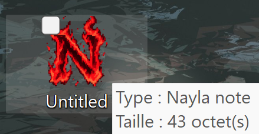
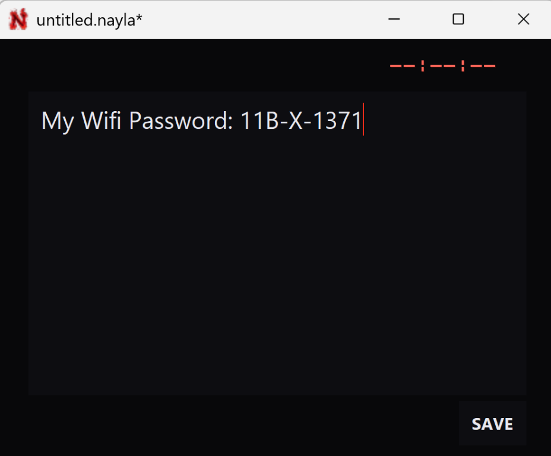
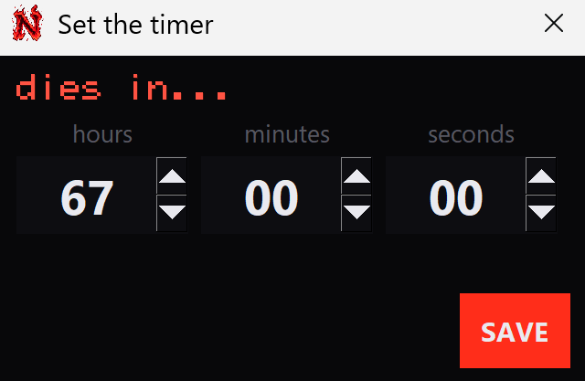
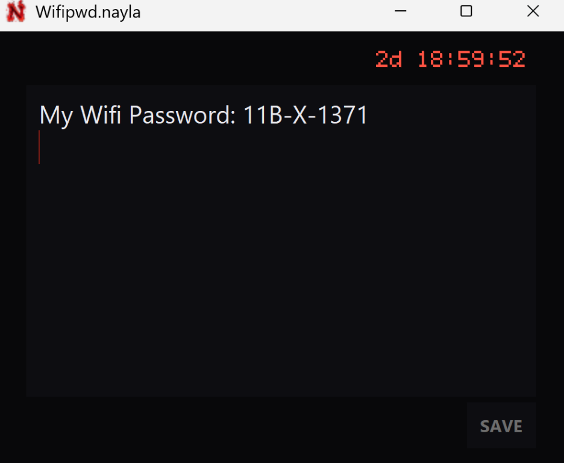

# dotnay — timed, self-deleting notes

<p align="center">
  
</p>

dotnay is a plain-text note app that deletes each note when its timer expires.

A `.nayla` file is ordinary UTF-8 text with a timer attached. When the timer
runs out in the desktop app, the note fades away and the file is deleted.

This is file deletion, not secure erasure: backups, sync services, and copies
you made elsewhere are not magically deleted too. dotnay is a timer with
boundaries, not a forensic-destruction service :|

## For users

1. Download `dotnay-setup.exe` from Releases.
2. Double-click it and click **Next** a few times. No administrator prompt,
   no summoning ritual.
3. Open **dotnay** from the Start Menu, double-click a `.nayla` file, or
   right-click in Explorer and choose **New > dotnay note**.

The installer registers `.nayla`, adds a Start Menu shortcut, and offers an
optional desktop shortcut. No Python setup required. Uninstall from
**Settings > Apps** if your notes have reconciled with mortality.

## The desktop app

One dark editor, one red countdown, one SAVE button. Type first; then SAVE asks
how long the note has left. Reopen a saved note to edit it, but its original
deadline stays put. The timer does not reset just because the note got a
second draft.

A note created with **New > dotnay note** starts as an empty file. Its name is
kept, and dotnay writes the actual note format the first time you save it.

<p align="center">
  
  
</p>
<p align="center">
  
</p>

## Format specification

A `.nayla` file is a plain UTF-8 text. Three required lines at the top, then the note:

```
NAYLA
expires: 24h
---
The content of the note goes here.
```

### The rules (yes, there are rules)

1. Line 1 must be exactly `NAYLA` (case-sensitive). A UTF-8 BOM is tolerated;
2. Line 2 must start with `expires:` followed by one of:
   - A duration: a positive integer and a unit, `s`, `m`, `h`, or `d`.
     Examples: `30s`, `15m`, `24h`, `7d`.
   - An exact local date and time in `YYYY-MM-DD HH:MM` or
     `YYYY-MM-DD HH:MM:SS` form.
     Example: `2026-11-04 18:00` or `2026-11-04 18:00:30`.
3. Line 3 must be exactly `---`.
4. Everything after line 3 is the note, preserved verbatim, including blank
   lines and trailing newlines. The note may ramble; the header may not.
5. CRLF and LF line endings are both accepted. Windows and Unix can stop
   arguing about line endings for at least one file.

### Expiry semantics

- A duration is measured from the file's creation time:
  - Windows: file creation time.
  - macOS: birth time.
  - Linux: birth time when the filesystem provides it, otherwise the last-modified time.
- An exact date is interpreted as local time and does not depend on creation time.
- A file is expired when the current time is at or after the computed expiry.
  The format can still be parsed; the desktop app deletes an expired note
  rather than pretending it is still alive.

### Duration units

| Unit | Meaning | Seconds |
|------|---------|---------|
| `s`  | seconds | 1       |
| `m`  | minutes | 60      |
| `h`  | hours   | 3,600   |
| `d`  | days    | 86,400  |

## Examples

See the `examples/` folder.

- `quick-note.nayla` - lasts 24 hours from creation.
- `short-lived.nayla` - lasts 30 minutes from creation.
- `exact-date.nayla` - expires at a specific local date and time.

## Usage

Requires Python 3.9 or newer.

```powershell
python -m dotnay.cli examples/quick-note.nayla
```

Output:

```
Expires: 2026-11-04 14:32:10 (23:59:59.123456 left)
---
Remember to water the plants before the timer runs out.
```

Invalid files produce a single clear message and exit with code 1:

```
Invalid .nayla file: Line 3 must be '---', found 'note'
```

Optional editable install, which also provides the `nayla` command:

```powershell
pip install -e .
nayla examples/short-lived.nayla
```

## Desktop app details

- **Save and timer.** Write your note and click `SAVE`. Set the timer with
  hour, minute, and second fields, then click `SAVE`. A note opened from an
  existing `.nayla` file saves back to it; otherwise the standard Save As
  dialog opens with `untitled.nayla`. The timer begins when the file is saved.
- **Reopen.** The note text remains editable and can be saved, but the
  countdown at the top is locked to its original deadline. Editing is not
  time travel.
- **The end.** The countdown keeps running while the app is open. At zero the
  text fades into the background, then the `.nayla` file is deleted. If the
  app is closed, it cannot hover over the file menacingly; an expired note is
  removed when dotnay next opens it.
- **Windows file icon.** Register the `.nayla` extension for your Windows
  user to display the burning-N icon in Explorer and open notes with dotnay:

  ```powershell
  python -m dotnay.file_association
  ```

  This sets dotnay as the default app for `.nayla` files for the current user.
  The command works from the project folder and does not require installing
  dotnay first. Windows may take a moment to refresh existing file icons.

  A standalone build can register itself instead:

  ```powershell
  dist\dotnay.exe --register
  ```

Requires only Python and Tkinter (bundled with the official Windows/macOS
installers):

```powershell
python -m dotnay.app
python -m dotnay.app examples/exact-date.nayla
```

Or install it (adds a `dotnay` window launcher and the `nayla` CLI):

```powershell
pip install -e .
dotnay
```

Look: near-black background, a single "N" in the corner, red accents, one
font, and a softly pulsing red countdown. The icon is a burning pixel-art N.

## Standalone Windows app

Build a single `dotnay.exe` with PyInstaller. Python, Tkinter, and the icons are
bundled, so the result runs on machines without Python installed:

```powershell
pip install pyinstaller
python -m PyInstaller --noconfirm dotnay.spec
```

The executable is written to `dist/dotnay.exe`. It can live anywhere; put it in
a folder you keep, then register the file type from that exact location:

```powershell
dist\dotnay.exe --register
```

Double-clicking a `.nayla` file now opens it in the app, with the burning-N
icon. The registration stores the full path to the `.exe`, so re-run
`--register` after moving or renaming it. Set `DOTNAY_NO_UI=1` to skip the
confirmation dialog when registering from a script or installer.

## Build the installer

The installer wraps the standalone app so users only need to download and
double-click it.

1. Install [Inno Setup](https://jrsoftware.org/isdl.php) (version 6 or newer;
   7 works too).
2. Run the build script from the project folder:

   ```powershell
   powershell -ExecutionPolicy Bypass -File tools\build_installer.ps1
   ```

The script builds `dist\dotnay.exe` with PyInstaller, compiles
`installer\dotnay.iss`, and prints the installer path: `dist\dotnay-setup.exe`.

The installer is per-user (no administrator prompt), installs to
`%LOCALAPPDATA%\Programs\dotnay`, registers `.nayla` files in
`HKCU\Software\Classes`, adds the Explorer **New > dotnay note** entry, adds a
Start Menu shortcut and an optional desktop shortcut, and includes an
uninstaller. A fixed `AppId` means a newer `dotnay-setup.exe` upgrades the
existing install in place.

---

*If you made it all the way down here, congratulations: this README has
outlived at least one note. Go write something worth deleting.*
